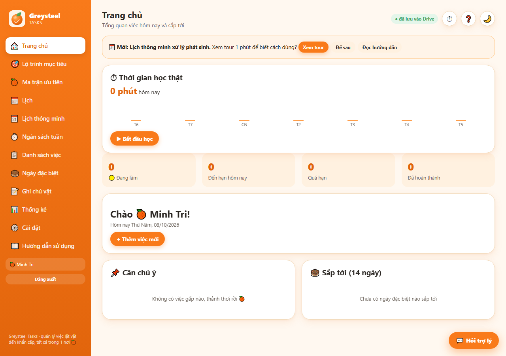
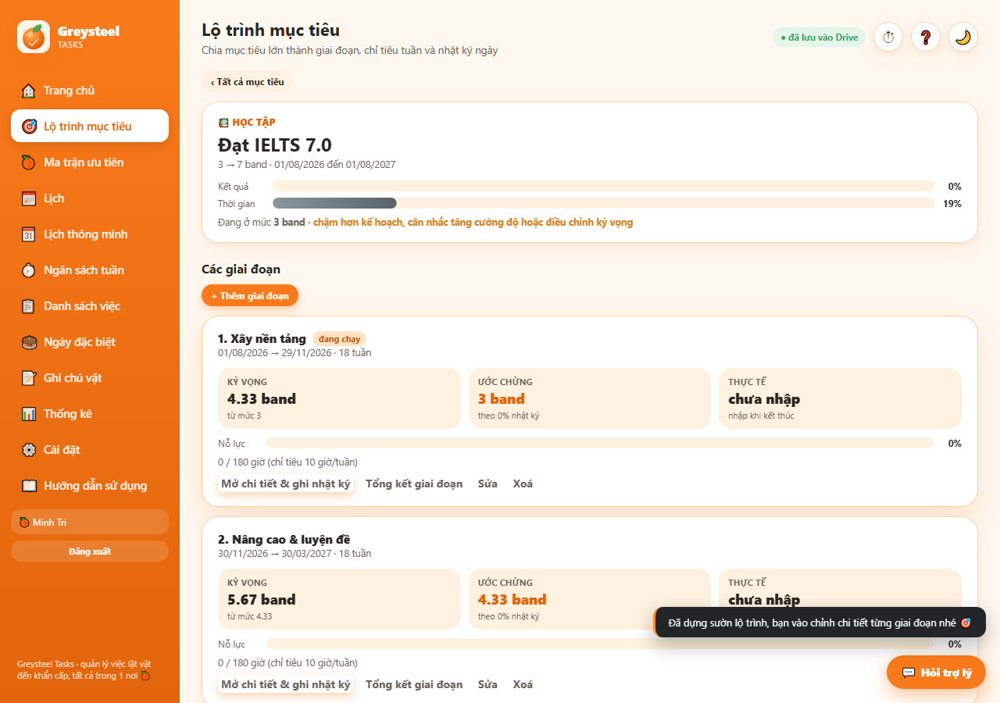
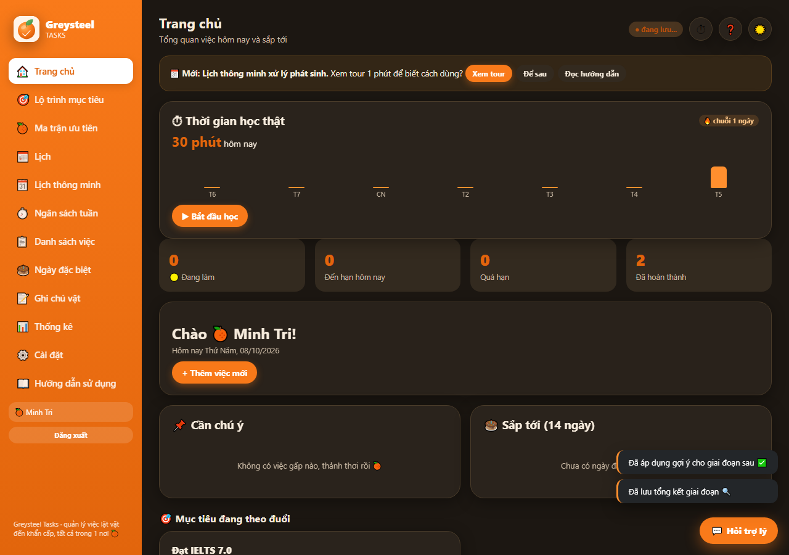

# Greysteel Tasks 🍊

**A personal planner that turns long term goals into weekly targets and a smart calendar that reschedules itself when life gets in the way.**

Live: **[greysteeltask.netlify.app](https://greysteeltask.netlify.app)** · Sign in with Google, data stays in your own Google Drive.

[English](#english) · [Tiếng Việt](#tieng-viet)



<a id="english"></a>

## English

### Why I built it

I study best with momentum and long sessions, but plans break the moment something unexpected comes up. Normal to do apps only list tasks. I wanted an app that knows my weekly time budget, notices when I fall behind, and moves the missed work to free slots for me.

### Features

- **Goal roadmap**: split a big goal (for example IELTS 7.0) into phases with expected results, weekly hour targets and a daily log. At the end of each phase, compare expectation vs reality and adjust.
- **Smart calendar**: a scheduling engine places tasks into a weekly template. When a session is missed or an event appears, it re-plans automatically ("xếp bù") and syncs with Google Calendar both ways.
- **Weekly budget and check ins** to see real study time vs plan.
- **Flowtime study timer** that records real focus time.
- **Quick paste schedule**: paste a timetable as plain text and it becomes calendar blocks.
- **AI assistant** (Claude API) that proposes changes; every change needs the user's approval and can be undone.
- **Priority matrix, special days, notes, statistics, dark mode**, installable as a PWA on phones.
- **Built in onboarding tour and user guide.**



### Architecture

| Part | Tech |
|---|---|
| Frontend | Vanilla JS PWA (`public/`): `engine.js` scheduling logic, `datastore.js` storage and migrations, `calsync.js` Google Calendar sync |
| Backend | Netlify Functions: Google OAuth with refresh tokens kept server side so users stay logged in for months, AI assistant proxy |
| Storage | Each user's own Google Drive `appDataFolder` (no database, no user data on my server) |
| Security | HTTP only session cookie, CSP and security headers in `netlify.toml` |

### Testing

```bash
npm install
npm test           # engine, data migration, calendar sync, assistant, auth functions
node test_full.js  # end to end in a real browser (Playwright) against a fake Google server
```

`test_fake_google.js` simulates Google OAuth, Drive and Calendar (including sync token expiry, HTTP 410) so the whole app can be tested offline.

### Run your own copy

See [HUONG_DAN.md](HUONG_DAN.md) (Vietnamese) for creating Google OAuth credentials and deploying to Netlify.



<a id="tieng-viet"></a>

## Tiếng Việt

App quản lý việc cá nhân, mình tự làm để học đều hơn:

- **Lộ trình mục tiêu**: chia mục tiêu lớn thành giai đoạn, chỉ tiêu giờ mỗi tuần, nhật ký mỗi ngày, cuối giai đoạn đối chiếu kỳ vọng và thực tế.
- **Lịch thông minh**: tự xếp việc vào lịch khung, lỡ buổi hay có việc phát sinh thì tự xếp bù, đồng bộ hai chiều với Google Calendar.
- **Ngân sách tuần, đồng hồ học Flowtime, dán lịch nhanh, trợ lý AI** (chỉ đề xuất, người dùng duyệt mới áp dụng).
- Dữ liệu nằm trong Google Drive của chính người dùng, đăng nhập một lần dùng nhiều tháng, cài được như app trên điện thoại.

Hướng dẫn cài đặt và triển khai chi tiết: [HUONG_DAN.md](HUONG_DAN.md).

---

**Phạm Nguyễn Minh Trí** · [GitHub @mtri0407](https://github.com/mtri0407)
